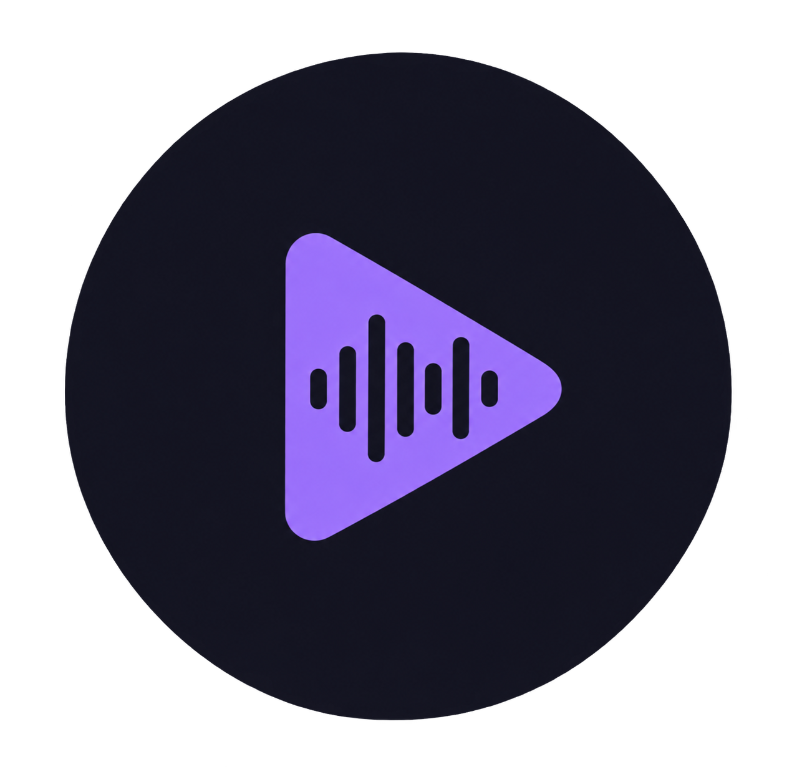
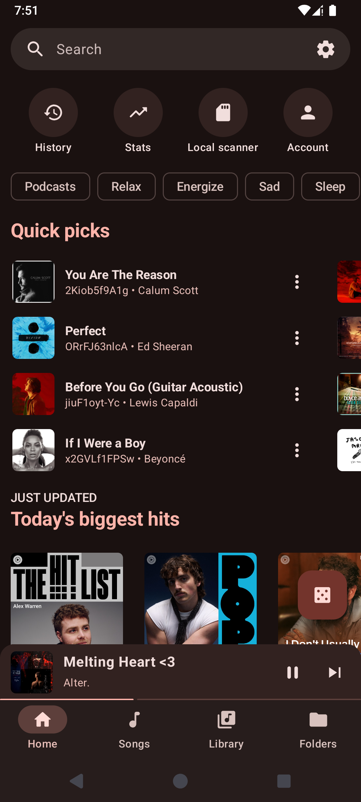
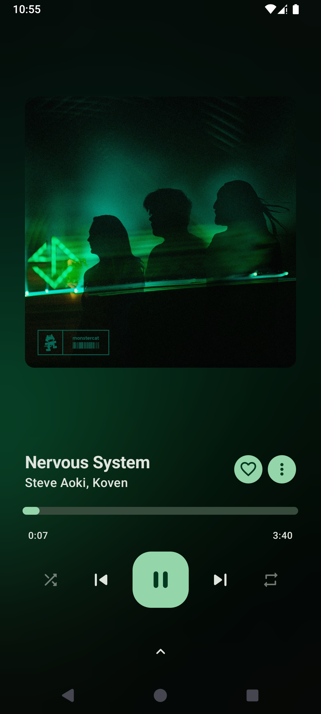
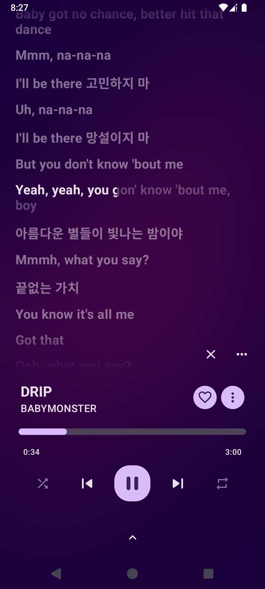
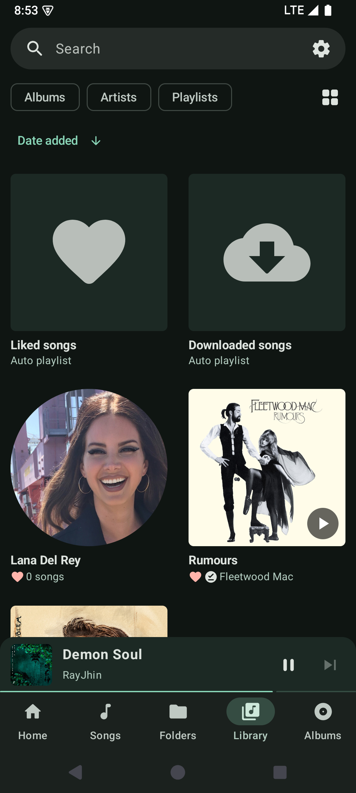
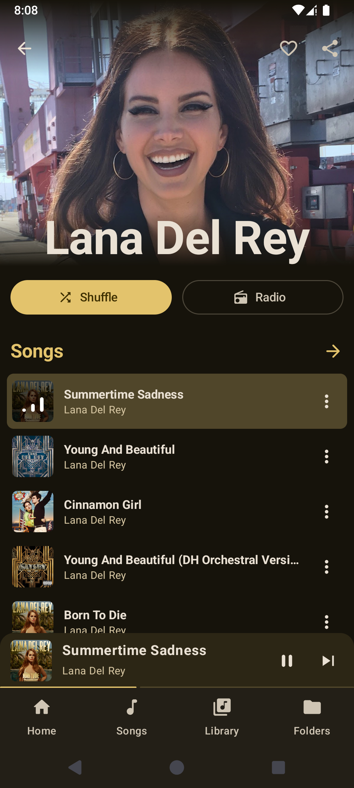
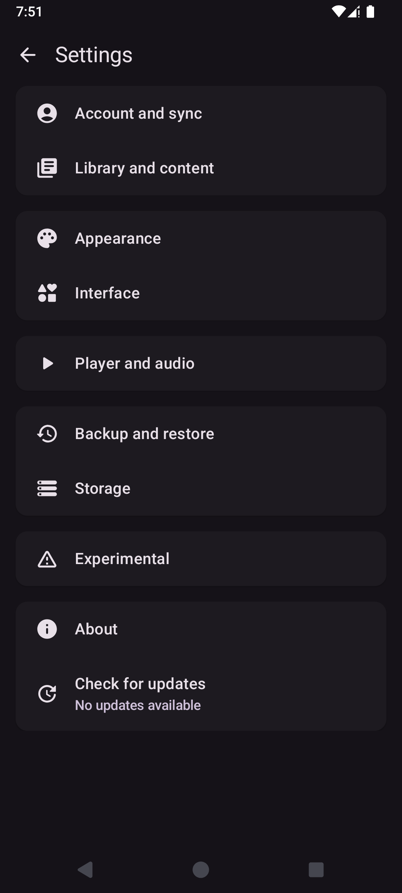

  
  <h1>Vynce</h1>
  
<b>The ultimate premium Music Experience for Android and Desktop (Windows)</b>

  
  
  

---

Vynce is a high-performance, Material 3 music streaming and playback application designed for audiophiles. Built and evolved upon the open-source foundation of OuterTune, Vynce delivers high-res 320kbps streaming, synchronized lyrics, Spotify playlist curation, rich home screen widgets, and detailed listening analytics.

---

## 📱 Vynce for Android

### ✨ Key Features
- 🎵 **Unlimited High-Res Streaming**: Access 100M+ songs at **320kbps** with lossless caching.
- 📱 **Native Home Screen Music Widget**: Sleek dark card with album art, live progress ticker, and 5 interactive controls (Shuffle, Prev, Play/Pause, Next, Favorite).
- 📊 **Detailed Insights & Listening DNA**: Deep analytics for your listening habits with time filters (All Time, Month, Week, Today), top tracks, and daily distribution.
- 🔎 **Discovery & Curated Mixes**: Spotify playlists, curated mixes on search, high-res artwork, and Shazam-style music recognition.
- 🎨 **Modern Aesthetics**: Full Material 3 support with **Dynamic Colors** (Android 12+), glassmorphic backdrops, and fluid gesture navigation.
- 💿 **Album Art & Visuals**: Rotating vinyl effects, sleek transitions, and a built-in audio visualizer.
- 📂 **Local Library & Offline Mode**: High-fidelity support for MP3, **FLAC**, OGG, and AAC, plus one-tap album & playlist downloads.
- 💬 **Synchronized Lyrics**: Support for LRC and TTML synced lyrics with shareable lyric cards.
- 🚗 **On the Road**: Full **Android Auto** integration.
- 📻 **Scrobbling & Backup**: Last.fm scrobbling, M3U/JSON playlist import/export, and seamless data backup.

### 📸 Screenshots

  <table>
    <tr>
      <td width="33%"></td>
      <td width="33%"></td>
      <td width="33%"></td>
    </tr>
    <tr>
      <td align="center"><b>Home</b></td>
      <td align="center"><b>Now Playing</b></td>
      <td align="center"><b>Synced Lyrics</b></td>
    </tr>
       <tr>
      <td width="33%"></td>
      <td width="33%"></td>
      <td width="33%"></td>
    </tr>
    <tr>
      <td align="center"><b>Library</b></td>
      <td align="center"><b>Artist</b></td>
      <td align="center"><b>Settings</b></td>
    </tr>
  </table>

### 🛠 Android Tech Stack
- **Language**: Kotlin
- **UI Framework**: Jetpack Compose
- **Core**: Media3 & ExoPlayer
- **Database**: Room
- **Networking**: OkHttp & Retrofit
- **Dependency Injection**: Hilt

### 🚀 Android Quick Start
1. **Download**: Grab the latest APK from the [Releases](https://github.com/2300030811/Vynce/releases/latest) page.
2. **Install**: Enable "Install from Unknown Sources" on your device if prompted.
3. **Enjoy**: Open Vynce and start your journey through music.

---

## 🖥️ Vynce Desktop (Windows)

Vynce Desktop brings the high-fidelity Vynce streaming experience to the desktop, built with React 19, TypeScript, Vite, Tailwind CSS, and Electron. It features direct 320kbps JioSaavn streaming, synchronized lyrics, Spotify playlist curation, local offline caching, and seamless Windows desktop integration.

### 💻 Supported Platforms
- **Windows 10 & Windows 11 (64-bit / x64)**
- Packaged as both an **NSIS Installer** and a **Standalone Portable Executable**.

### 📦 Choosing Your Windows Download
When a desktop release is published on the [Releases](https://github.com/2300030811/Vynce/releases) page, two package formats are provided:

1. **Windows Installer (`Vynce Setup <version>.exe`)**:
   - Recommended for daily desktop use.
   - Standard setup wizard with custom installation folder selection.
   - Installs per-user to `%LOCALAPPDATA%\Programs\Vynce Music`.
   - Creates Windows Start Menu shortcuts and a desktop shortcut (`Vynce Music`).
   - Clean uninstallation via Windows Settings (*Installed Apps*) or Control Panel.

2. **Portable Executable (`Vynce <version>.exe`)**:
   - Single standalone executable requiring no installation.
   - Run directly from any folder, USB flash drive, or external storage.
   - Leaves no Windows registry entries or uninstaller records in Windows Settings.

### 🛡️ First Launch & Windows SmartScreen Notice
> [!NOTE]
> **Why does Windows SmartScreen show a warning?**  
> Vynce is a free, community-driven open-source project and does not carry an expensive commercial Extended Validation (EV) code-signing certificate. On first launch, Windows Defender SmartScreen may display:
> *"Windows protected your PC — Microsoft Defender SmartScreen prevented an unrecognized app from starting."*
> 
> **To launch Vynce:**
> 1. Click **More info**.
> 2. Click the **Run anyway** button.

### 🪟 Desktop Window Controls & System Tray Lifecycle
- **Frameless Dark Titlebar**: Custom draggable titlebar with Minimize, Maximize/Restore, and Close buttons.
- **Close to System Tray**: Clicking the **X** (close) button does **not** stop your music. Vynce hides to the Windows System Tray (notification area) so your audio continues playing uninterrupted in the background.
- **Restoring Vynce**: Double-click the Vynce icon in your Windows system tray, or right-click the tray icon and select **Show Vynce**.
- **Explicit Exit / Quit**: To completely terminate Vynce, right-click the system tray icon and select **Quit Vynce**.
- **Single Instance Enforcement**: Launching a second instance automatically brings the existing window to the foreground without spawning duplicate processes.
- **Windows Media Controls (SMTC)**: Hardware keyboard multimedia keys (Play/Pause, Next, Previous) and Windows System Media Transport Controls are supported out of the box.

### 🔄 Automatic Updates & Verification Status
- **Update Checks**: In Vynce Desktop, open **Settings** -> **Desktop App & Updates** and click **Check for Updates** to verify your version against official GitHub Releases.
- **Release Manifest Requirement**: Automatic in-place background updates require official published GitHub releases with corresponding `latest.yml` manifests. Update checks report honest status if a release manifest is not yet published.
- **Verification Status**: Core playback, race-condition-free search, asset loading, system tray minimize, and UI interactions have been verified in real Windows runtime and automated regression suites. Full end-to-end auto-update installation will be enabled with the first public GitHub release.

### 🛠️ Desktop Tech Stack
- **Shell**: Electron 34
- **Frontend**: React 19, TypeScript 5, Vite 8, Tailwind CSS 4
- **State & Storage**: Zustand 5, Dexie.js (IndexedDB), CacheStorage
- **Icons & Motion**: Lucide React, Framer Motion

---

### 🤝 Contributing
Contributions are welcome! Feel free to open issues or submit pull requests. For desktop-specific bugs or suggestions, please label issues accordingly at [GitHub Issues](https://github.com/2300030811/Vynce/issues).

### 📜 License
This project is licensed under the **GPL-3.0 License**.